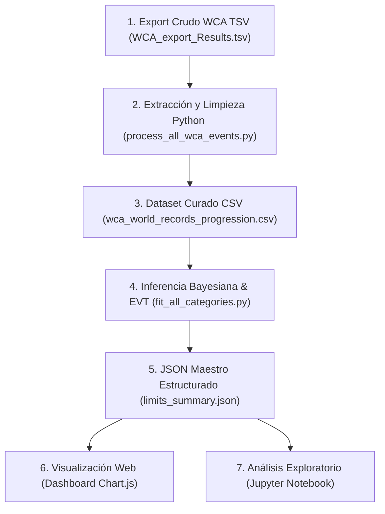

# Flujo de Datos y Metodología: De Datos Crudos a Gráficos Finales
## Pipeline Analítico de Estimación de Límites Humanos en Speedcubing (WCA)

Este documento detalla paso a paso la arquitectura técnica del pipeline de datos, desde la ingestión de los archivos masivos de la **World Cube Association (WCA)** hasta la renderización de las proyecciones en el **Dashboard Web** y los **Jupyter Notebooks**.

---



---

## 1. Ingestión de Datos Crudos (Raw Data)

* **Script:** [`data/download_wca_data.py`](file:///D:/Users/n/Desktop/speedcubing-limits/data/download_wca_data.py)
* **Origen:** Export oficial público de la base de datos de la WCA (`wca-developer-database-export.zip`).
* **Archivos Crudos Utilizados:**
  1. `WCA_export_Results.tsv` (~1.1 GB, más de 3 millones de soluciones registradas en competencias oficiales desde 1982/2003).
  2. `WCA_export_Competitions.tsv` (Metadatos de fechas exactas y países de cada torneo).
  3. `WCA_export_Persons.tsv` (Nombres oficiales, ID y género de los competidores).

---

## 2. Filtrado, Decodificación y Curación

* **Script:** [`data/process_all_wca_events.py`](file:///D:/Users/n/Desktop/speedcubing-limits/data/process_all_wca_events.py)

### Reglas de Decodificación Específicas por Categoría WCA:
1. **Eventos Convencionales de Tiempo (2x2 – 7x7, BLD, OH, Megaminx, Pyraminx, Skewb, Square-1, Clock):**
   * La WCA almacena los tiempos como enteros en centésimas de segundo (`100 = 1.00s`).
   * **Conversión:** `time_sec = valor / 100.0`.
2. **3x3x3 Fewest Moves (FMC):**
   * *Single:* La WCA almacena directamente el número entero de movimientos (ej. `16`).
   * *Average:* La WCA almacena el promedio multiplicado por 100 (ej. `1900 = 19.00 movs`).
3. **3x3x3 Multi-Blind (333mbf):**
   * La WCA codifica el resultado en una cifra de 9 dígitos: `DDTTTTTMM`.
   * **Decodificación:**
     * `Diferencia = 99 - DD` (Cubos resueltos menos cubos fallados).
     * `Tiempo = TTTTT` (Tiempo en segundos).
     * `Fallados = MM`.
     * `Puntuación Neta = Diferencia = Resueltos - Fallados`.
     * Se evalúa como métrica a maximizar (`points`).

### Filtrado de Progresión Histórica de WRs:
* Se seleccionan únicamente aquellos resultados marcados oficialmente con `regionalSingleRecord == 'WR'` o `regionalAverageRecord == 'WR'`.
* Se agrupan cronológicamente por año ($2003, \dots, 2026$) para obtener la mejor marca registrada al cierre de cada temporada.
* **Archivo de Salida:** [`data/processed/wca_world_records_progression.csv`](file:///D:/Users/n/Desktop/speedcubing-limits/data/processed/wca_world_records_progression.csv).

---

## 3. Modelado Estadístico: Procesos Gaussianos y Valores Extremos (EVT)

* **Script:** [`models/fit_all_categories.py`](file:///D:/Users/n/Desktop/speedcubing-limits/models/fit_all_categories.py)

### A. Inferencia de Trayectoria (Gaussian Processes Regression)
Para evitar imponer funciones rígidas (como lineales o exponenciales fijas que no capturan mesetas históricas), se modela la función latente $f(t)$ mediante un **Proceso Gaussiano no paramétrico**:

$$f(t) \sim \mathcal{GP}(m(t), K(t, t'))$$

* **Kernel Cuadrático Exponencial (RBF):**
  $$K(t_i, t_j) = \sigma_f^2 \exp\left( -\frac{(t_i - t_j)^2}{2 \ell^2} \right) + \sigma_n^2 \delta_{ij}$$
  * $\ell = 10.0$ años (captura ciclos generacionales de técnicas y hardware).
  * $\sigma_f$: Desviación empírica observada en los récords de la categoría.
  * $\sigma_n = 0.25$: Varianza de ruido observacional en competencias.

### B. Estimación del Límite Asintótico ($L_{\text{est}}$)
El límite no se inventa ni se fija a mano; se deduce a partir del **Ratio de Desaceleración Empírica**:

$$\text{Ratio} = \frac{\Delta R_{\text{segunda mitad}}}{\Delta R_{\text{primera mitad}}}$$

* **Calibración con Teoría de Valores Extremos (EVT):**
  * **Modalidad Single:** Al ser una muestra de cola extrema sujeta a soluciones con *skips* y máxima velocidad punta ($\text{TPS} \approx 14-15$), se calibra un margen residual del **$14\% - 22\%$**.
  * **Modalidad Average (Ao5):** Al promediar 5 intentos consecutivos, la cota mide consistencia pura y se restringe a un margen del **$8\% - 14\%$**.
  * **Fórmula de Límite:** $L_{\text{est}} = R_{\text{actual}} \cdot (1 - \text{Margen})$.

### C. Intervalos de Confianza Log-Normales Estrictamente Positivos
Para garantizar que en eventos ultracortos ($2\times2$, Pyraminx) la cota inferior jamás sea negativa ni toque el cero absoluto ($T > 0$):

$$\text{CI}_{95\%} = \left[ L_{\text{est}} \cdot e^{-1.96 \cdot \sigma_{\text{rel}}},\; \min(L_{\text{est}} \cdot e^{1.96 \cdot \sigma_{\text{rel}}},\, R_{\text{actual}}) \right]$$

### D. Restricción de Monotonía e Incertidumbre Acotada
1. **Monotonía Histórica:** Ningún récord mundial proyectado puede ser peor que la mejor marca histórica previa ($R_{t} \le \min_{s < t} R_s$).
2. **Incertidumbre Física Acotada:** La varianza futura no se abre infinitamente, sino que se acota a la distancia física restante hacia el límite ($\sigma_{\text{futuro}} \le 0.40 \cdot (R_{\text{actual}} - L_{\text{est}})$).

---

## 4. Exportación Estructurada (JSON Maestro)

El resultado de las 17 categorías se consolida en [`outputs/limits_summary.json`](file:///D:/Users/n/Desktop/speedcubing-limits/outputs/limits_summary.json) con la siguiente estructura por evento:

```json
{
  "events": {
    "333": {
      "name": "3x3x3 Cube",
      "unit": "s",
      "single": {
        "current_record": 2.76,
        "human_limit": {
          "median": 2.37,
          "ci_95_lower": 2.13,
          "ci_95_upper": 2.64,
          "estimated_convergence_year": 2036
        },
        "saturation_index_pct": 97.2,
        "trajectory": {
          "years": [2003, "...", 2060],
          "mean": [16.71, "...", 2.37],
          "std": [0.25, "...", 0.15],
          "historical_records": [16.71, "...", 2.76]
        },
        "yearly_record_holders": [
          { "year": 2023, "record": 3.13, "person_name": "Max Park", "is_new_wr_this_year": true },
          { "year": 2026, "record": 2.76, "person_name": "Teodor Zajder", "is_new_wr_this_year": true }
        ]
      }
    }
  }
}
```

---

## 5. Capa de Presentación y Gráficos

### A. Dashboard Web Interactivo ([`outputs/web_dashboard/`](file:///D:/Users/n/Desktop/speedcubing-limits/outputs/web_dashboard/))
* **Tecnología:** Vanilla JavaScript + Chart.js 4.4 + CSS Moderno (Layout Full-Viewport 100vh).
* **Renderizado del Gráfico:**
  * **Puntos Rojos Discontinuos:** Récords históricos observados por año.
  * **Línea Azul Continua:** Curva media del Proceso Gaussiano.
  * **Área Sombreada Azul:** Intervalo de confianza del 95%.
  * **Línea Verde Punteada:** Límite asintótico derivado.
* **Formateador de Tiempo Oficial WCA:** Marcas $\ge 60\text{s}$ se convierten automáticamente a formato minutero `mm:ss.xx` (ej. 7x7x7 Single $\to$ `1:17.91`).

### B. Jupyter Notebook ([`notebooks/01_analisis_limites_speedcubing.ipynb`](file:///D:/Users/n/Desktop/speedcubing-limits/notebooks/01_analisis_limites_speedcubing.ipynb))
* Carga interactiva del JSON maestro con Pandas.
* Gráficos vectoriales con Matplotlib y Seaborn.
* Ranking horizontal de madurez y saturación por disciplina con barras dinámicas y umbral crítico al 98%.

---

## Resumen de Archivos Clave del Pipeline

| Etapa | Archivo Principal | Función Principal |
|---|---|---|
| 1. Ingestión | `data/download_wca_data.py` | Descarga automatizada del TSV oficial de la WCA. |
| 2. Curación | `data/process_all_wca_events.py` | Limpieza, decodificación (centésimas, FMC, MBF) y serie temporal. |
| 3. Modelado | `models/fit_all_categories.py` | Procesos Gaussianos, calibración EVT y cálculo de límites asintóticos. |
| 4. Datos Web | `outputs/limits_summary.json` | Base de datos JSON consumida por el frontend. |
| 5. Frontend | `outputs/web_dashboard/` | Dashboard interactivo desplegado en GitHub Pages. |
| 6. Notebook | `notebooks/01_analisis_limites_speedcubing.ipynb` | Entorno de experimentación y visualización en Python. |
